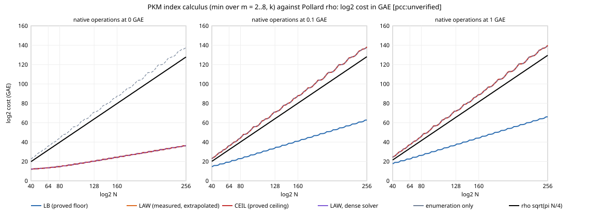

# A fully charged cost model of PKM prime-field index calculus against Pollard rho

**Every number on this page is `[pcc:unverified]`**: a model, computed on one
container on 2026-11-20, no pcc claim filed, no replay certificate, no
validator report. It is not a leaderboard or benchmark row, and no curve was
attacked for it.

Preregistration: [`PREREGISTRATION.md`](PREREGISTRATION.md), committed alone
before any model output (commit `0602ea6`). Code: the Rust crate in this
directory (`src/main.rs`, no Python). Generated files: `results/validation.md`
(validation against Study A), `results/headline.md` (all tables below and
more), `results/sweep.jsonl` (one row per `log2 N` from 40 to 256, scenario and
price, with the per-`m` optimum), `results/fig-cost.svg`.

## Question

The paper (`paper/curve-lfd-bounds.tex`; the per-failed-attempt reading in
Section `sec:meaning` of the PR #40 draft) bounds the solving degree of one
relation-search attempt of the Petit–Kosters–Messeng (PKM) attack. It does not
cost the whole attack. This model combines the paper's degree bounds with two
measured studies:

* **Study A** (`experiments/ic-endtoend/`): the relation yield
  `1 - exp(-|F|^m/(m! N))`, the relations needed (`0.53 f` for `m = 2`, `0.92 f`
  for `m = 3`), the linear algebra, and the measured end-to-end cost against
  rho at `N` up to `2^40`.
* **Study B** (`lfd-wt/msum-growth/experiments/msum-growth/`, commit
  `9142020`): the three-summand last fall degree (7 at `k = 2..5`, 8 at `k = 6`,
  `>= 8` at `k = 7`), four summands (13 at `k = 4`), and the closure cost
  `~4.5e-3 n^3` multiply-adds for `n` columns.

and asks where the minimum fully charged cost, over `m = 2..8`, the depth `k`
and the decomposition route, stands against `sqrt(pi N/4)` for `log2 N` from 40
to 256.

## Model (summary; the preregistration has every constant)

* `|F| = 2^k`, `f = 2^(k-1)`; the prime is assumed PKM-friendly
  (`2^k | p - 1`). For a generic prime such as P-256 or secp256k1
  (`v2(p - 1) = 1`) the attack does not apply at all.
* Attempts `A = rho_m f / (1 - exp(-lambda))`, `lambda = |F|^m/(m! N)`;
  1 walk addition and 3 bookkeeping operations each; setup `94 log2 N`
  additions; `m R` resolve additions.
* Linear algebra: `m = 2` `15` operations per relation (cycle search);
  `m >= 3` `4.73 m (0.65 f)^2 + 115 f`.
* Per attempt, the cheaper of **(a)** exact enumeration / meet in the middle
  (a table of all signed `a`-sums built once, `(2f)^(m-a)/(m-a)!` additions and
  lookups per attempt, `a` from `ceil(m/2)` to `m`), and **(b)** a
  Groebner/Macaulay solve on the direct chain presentation (`mk` variables) at
  degree `D(m, k)`:

| scenario | degree | solver cost per attempt |
|---|---|---|
| **LB**, proved floor | `m = 2`: `max(4, D+1 for k >= k_D)` on failed attempts only (`k_D = 27, 39, 52, 64, 77, 90, ...`, recomputed here, matching the paper; implies `floor((k-10)/14)+1`); successes charged 1. `m = 3`: 7. `m = 4`: 13 (`k >= 4`, hypotheses computed at `k = 4, 5` only). `m >= 5`: 2 (nothing proved). | `C(mk, D)` (top layer) |
| **LAW**, measured and extrapolated | `m = 2`: `floor((k+14)/4)`; `m >= 3`: `mk+1` for `k < m-1`, else `m(m-1)+1 + floor((k+14)/4) - 4` | `|M_<=D|^2` |
| **CEIL**, proved ceiling | `k+2` (`m = 2`), `mk+1` | `7.5e-3 |M_<=D|^3` |

* Total `GA + price * native`, price in `{0, 0.1, 1}` GAE (§5a band).
  Rho: `sqrt(pi N/4)(1 + 2.25 price)` (Study A's measured bookkeeping per step).
* "IC beats rho": cheaper at all three prices.

## Validation against Study A (preregistered gate) `[pcc:unverified]`

All 33 end-to-end cells of Study A, predicted with Study A's own route
(`a = 2`) and the nominal `f = 2^(k-1)`; full table in
[`results/validation.md`](results/validation.md).

| quantity | result | preregistered tolerance |
|---|---|---|
| scored cell-prices (`log2 p` 28 to 40) | 63 (21 cells x 3 prices) | |
| all within `[1/2, 2]` | **yes**; range 0.96 to 1.42 | every one |
| median `abs(log2(pred/meas))` | **0.067** (a factor 1.05) | `<= 0.5` |
| worst | factor 1.42 (`log2 p = 28`, `m = 3`, `k = 11`, price 1: the model charges a full scan of lookups on attempts that stop at the first hit, which matters only at `lambda > 1`) | |
| rho model / measured, `log2 p` 32, 36, 40 | 0.85 to 0.88, 0.91 to 0.92, 1.01 | `[0.75, 1.33]` |
| best-cell IC/rho, `log2 p = 40` | measured `98.5 / 108.1 / 134.7` (`m = 2`), `825 / 743 / 514` (`m = 3`); predicted `95.2 / 104.4 / 129.8`, `811 / 731 / 508` | (secondary) |

**The validation passes.** It is an in-sample consistency check, not an
out-of-sample test: the constants (relations needed, LA constant, bookkeeping,
setup) are Study A's pooled medians. What it does establish is that the
functional form (attempts `~ R/Pr`, table `~ f^2`, search `~ 2f` per attempt)
reproduces every cell across `k` and `p` with one set of constants. Cells at
`log2 p = 20, 24` (unscored) are within 0.67 to 1.96.

## Headline: minimum IC cost against rho `[pcc:unverified]`

Entry: `log2(IC/rho)` at price 0 / 0.1 / 1 (negative: IC cheaper), minimum
over `m = 2..8`, `k` and route. The minimizers are in
[`results/headline.md`](results/headline.md).

| log2 N | log2 rho | LB (proved floor) | LAW (measured, extrapolated) | CEIL (proved ceiling) | LB + measured onset (sensitivity) |
|---|---|---|---|---|---|
| 40 | 19.8 | -7.7 / -5.6 / -3.9 | -7.7 / +2.7 / +2.7 | -7.7 / +2.7 / +2.7 | -7.7 / +2.7 / +2.7 |
| 64 | 31.8 | -18.4 / -12.8 / -10.9 | -18.4 / +4.0 / +3.7 | -18.4 / +4.0 / +3.7 | -18.4 / +3.3 / +3.7 |
| 80 | 39.8 | -25.1 / -17.2 / -15.3 | -25.1 / +4.3 / +4.4 | -25.1 / +4.3 / +4.4 | -25.1 / +3.3 / +4.0 |
| 128 | 63.8 | -43.6 / -30.2 / -28.3 | -43.6 / +6.9 / +6.5 | -43.6 / +6.9 / +6.5 | -43.6 / +3.3 / +4.0 |
| 160 | 79.8 | -55.6 / -39.3 / -37.3 | -55.6 / +7.8 / +7.3 | -55.6 / +7.8 / +7.3 | -55.6 / +3.3 / +4.0 |
| 256 | 127.8 | -91.6 / -65.4 / -63.5 | -91.6 / +10.0 / +10.3 | -91.6 / +10.0 / +10.3 | -91.6 / +4.3 / +5.0 |
| **IC beats rho (all three prices)** | | **yes, at every `log2 N` from 40 to 256** (217 of 217), through `m = 8` (`m = 7` at `2^43`; each of `m = 5..8` suffices) with route (b) at `D = 2` | **nowhere** | **nowhere** | **nowhere** |



Who attains the minimum:

* **Price 0** in every scenario: route (b) with `m = 8`. At price 0 the
  solver is free, so an attempt costs one walk addition and IC costs about
  `R = rho_m f` additions, far below rho for `m >= 3`. This is the lower end of
  the band, not an attack: an `F_p` Macaulay solve at degree 57 to 273 is
  charged nothing. Even with a free solver, `m = 2` does not beat rho (`+0.44` to `+0.47`
  bits at every size: `R ~ 0.53 f` relations need `f ~ sqrt(N/2)`).
* **LAW and CEIL at prices 0.1 and 1**: always route (a), enumeration with a
  table of all `m`-sums (`a = m = 7` or `8`, `k = 5` to `19`). Route (b) is never
  cheaper, so these two rows equal the "enumeration only" row. The gap grows
  from `2^2.7` to `2^10.3`. Route (a) cannot beat rho in this model at any
  price. The table, the per-attempt search and the attempts multiply to at least
  `R N/2`, so the cost is at least `sqrt(2 R N) = sqrt(2 rho_m f N)`. That is
  above `sqrt(pi N/4)` for every `f >= 1`. This route also needs `2^75`
  bytes of table at `log2 N = 128`, which the model does not charge.
* **LB at prices 0.1 and 1**: route (b) at `D = 2` with `m >= 5`, the only
  degree the proved results allow there.

Per `m` at price 0.1 (`log2(IC/rho)`, best `k`; price 1 is in
`results/headline.md`):

| scenario | log2 N | m=2 | m=3 | m=4 | m=5 | m=6 | m=7 | m=8 |
|---|---|---|---|---|---|---|---|---|
| LB | 64 | +3.3 | +7.2 | +6.0 | -6.1 | -9.4 | -11.3 | -12.8 |
| LB | 128 | +3.3 | +13.8 | +10.7 | -16.3 | -22.4 | -27.2 | -30.2 |
| LB | 256 | +4.3 | +19.8 | +4.9 | -37.4 | -49.6 | -58.4 | -65.4 |
| LAW | 64 | +10.7 | +7.2 | +6.0 | +5.3 | +5.6 | +4.0 | +4.7 |
| LAW | 128 | +21.3 | +13.8 | +10.7 | +8.5 | +7.9 | +6.9 | +7.5 |
| LAW | 256 | +42.7 | +26.3 | +19.2 | +15.2 | +12.7 | +12.8 | +10.0 |

### What a lower bound would have to say (exploratory, not preregistered)

The least constant degree `D` that a lower bound for `m` summands would need
to keep IC at or above rho at price 0.1 / price 1. Route (b) is charged
`C(mk, D)` on every attempt and route (a) stays available. `-` means the
existing floor already suffices.

| log2 N | m=2 | m=3 | m=4 | m=5 | m=6 | m=7 | m=8 |
|---|---|---|---|---|---|---|---|
| 40 | - | - | 3 / 2 | 3 / 3 | 4 / 3 | 4 / 3 | 4 / 4 |
| 80 | - | - | 4 / 3 | 6 / 5 | 6 / 6 | 7 / 6 | 7 / 7 |
| 128 | - | - | 6 / 6 | 8 / 8 | 9 / 9 | 10 / 10 | 11 / 10 |
| 256 | - | - | 12 / 11 | 15 / 15 | 17 / 17 | 19 / 18 | 20 / 20 |

For `m = 4` the paper's 13 (conditional) suffices up to `2^256`. For
`m = 5..8` the required degrees 3 to 20 lie far below the measured onset
`deg g + 1 = m(m-1) + 1 = 21, 31, 43, 57`. They also lie below the forced
value `mk + 1` at small `k`. The "LB + measured onset" column charges exactly
that onset, with the largest layer `C(mk, min(D, mk/2))` as the floor
(deviation 2). Every win then disappears. From `2^75` on the cheapest IC is the `m = 2`
proved floor, `2^3.3` to `2^5.0` above rho (below that, the `a = m` enumeration).

## Predictions against outcomes

| id | prediction | outcome |
|---|---|---|
| P1 | the validation passes | **held** (median factor 1.05, worst 1.42, rho 0.85 to 1.01) |
| P2 | LAW and CEIL at prices 0.1 and 1: route (a) minimal, IC never beats rho | **held** at every `log2 N` from 40 to 256 |
| P3 | price 0: IC below rho for `m >= 3` in every scenario (artifact) | **held**; also `m = 2` stays above rho at price 0 (`+0.44`) |
| P4 | LB: IC beats rho at all three prices only through `m >= 5` | **held**, and not only at large `N`: at every size from `2^40` (`m = 5` alone from `2^40` at price 1, `-0.8`) |

## Where IC beats rho, and what that rests on

**Only in the LB scenario, only with `m >= 5`, at every size from `2^40` to
`2^256`.** This is not evidence that the attack works. It shows that the
*proved* results do not exclude it. For `m >= 5` at depth `k >= m - 1`
nothing bounds the solving degree from below except the trivial 2, and a
Macaulay solve at degree 2 in `mk` variables costs only `~(mk)^2/2`
operations per attempt. The win also uses three extrapolations: the yield law
for `m >= 5` (measured for `m = 2, 3`), the m-XORSAT relation count (measured
for `m = 3`), and the `m = 3` LA constant. Charging the measured onset
`lfd >= deg g + 1 = m(m-1) + 1` removes every win. That onset is the
kernel-checked carry statement, with its hypotheses checked by computation
only for `m <= 4`.

**Under the measured law (LAW) and the proved ceiling (CEIL) IC never beats
rho at prices 0.1 and 1, for `m <= 8` and `log2 N` from 40 to 256.** The
distance remaining grows from `2^2.7` at `2^40` to `2^10.3` at `2^256`. This
conclusion does not need the law beyond its onset. Route (b) is never chosen,
so LAW and CEIL equal enumeration alone, which is at least
`sqrt(2 rho_m f N)`. What keeps route (b) out under LAW is the degree:
LB + onset already keeps it out, and the onset is `m(m-1)+1`, with the paper's
`7` and `13` for `m = 3, 4`.

## LB-proved: the all-`m` carry bound as the degree floor (2026-11-20) `[pcc:unverified]`

**New input.** For the direct `m`-summand system with `m >= 3`,
`lfd >= m min(k, m-1) + 1 = deg g + 1`
(`lfd-wt/carry-allm/paper/notes/carry-allm.tex`, Theorem `thm:main`). Status:
**written proof, under review**. The abstract core (`lfd_ge_onset`,
`lfd_ge_full`) is kernel-checked in `formal/ICFallDegrees/CarryAllM.lean`.
Proposition `prop:grid` and the facts about `S_{m+1}` for `m >= 4` (shape of
`c_m`, `kappa_m != 0`) are not formalized. Hypotheses:

* `k >= m`: `c_m(a,b,t) != 0`. This excludes at most `m` targets per curve.
  The bound is charged on every attempt.
* `k <= m-1`: `gamma_{m,k} != 0` and the grid condition. `gamma_{m,k}` is
  nonzero outside a proper Zariski-closed set of `(a,b,t)`. That is generic,
  not "at most `m` per curve", and the model assumes it holds. The grid
  condition is proved on unit ideals, i.e. on failed attempts. As for `m = 2`,
  successes are charged 1, which favours the attacker.

**Scenario.** LB-proved is LB with the `m >= 3` degree replaced by
`m min(k, m-1) + 1`. `m = 2` keeps its proved per-failed-attempt floor.
Route (a), enumeration, stays available. The solver floor is the cheapest-solver
`C(mk, D)`, kept with the monotone convention of the LB + onset row (deviation 2):
`C(mk, min(D, floor(mk/2)))`, the largest layer `<= D`. It equals `C(mk, D)`
wherever `D <= mk/2`, and it is still at most `|M_<=D|`. The literal top
layer `C(mk, min(D, mk))` is reported as a sensitivity row. It is not monotone
in `D`. At the forced full degree `D = mk + 1` (every `k <= m - 1`) it charges
**1** per attempt, less than `D = 2` does. The optimizer exploits exactly that.

**Correction to the premise.** The old "LB + measured onset" row did *not*
use `m(m-1)+1` at every `k`. For `m >= 5` the code used `mk + 1` for
`k < m - 1` and `m(m-1) + 1` otherwise, which is already `m min(k, m-1) + 1`.
For `m = 3, 4` it used the LB values: 7 for `k >= 3` and 13 for `k >= 4`, else 2.
So LB-proved differs from LB + onset only at `m = 3, k = 2` (7 instead of 2),
at `m = 4, k = 2, 3` (9 and 13 instead of 2), and in charging successes 1 at
`k <= m - 1`. None of these cells is ever a minimizer. **Across all 651
cell-prices (`log2 N` 40 to 256, three prices), LB-proved equals LB + onset
exactly.** Every earlier scenario is unchanged too: 3906 of 3906 rows of
`sweep.jsonl` are identical, and the validation still passes with the same
numbers.

Re-sweep: every integer `log2 N` from 40 to 256, `m = 2..8`, `k` free, prices
0 / 0.1 / 1. The validation gate runs first and passes. The tables are in
`results/headline.md`.

| log2 N | log2 rho | LB | LAW | CEIL | LB + onset | **LB-proved** | LB-proved, literal top layer |
|---|---|---|---|---|---|---|---|
| 40 | 19.8 | -7.7 / -5.6 / -3.9 | -7.7 / +2.7 / +2.7 | -7.7 / +2.7 / +2.7 | -7.7 / +2.7 / +2.7 | **-7.7 / +2.7 / +2.7** | -7.7 / -6.6 / -5.9 |
| 64 | 31.8 | -18.4 / -12.8 / -10.9 | -18.4 / +4.0 / +3.7 | -18.4 / +4.0 / +3.7 | -18.4 / +3.3 / +3.7 | **-18.4 / +3.3 / +3.7** | -18.4 / -2.3 / -1.9 |
| 80 | 39.8 | -25.1 / -17.2 / -15.3 | -25.1 / +4.3 / +4.4 | -25.1 / +4.3 / +4.4 | -25.1 / +3.3 / +4.0 | **-25.1 / +3.3 / +4.0** | -25.1 / +3.3 / +4.0 |
| 128 | 63.8 | -43.6 / -30.2 / -28.3 | -43.6 / +6.9 / +6.5 | -43.6 / +6.9 / +6.5 | -43.6 / +3.3 / +4.0 | **-43.6 / +3.3 / +4.0** | -43.6 / +3.3 / +4.0 |
| 160 | 79.8 | -55.6 / -39.3 / -37.3 | -55.6 / +7.8 / +7.3 | -55.6 / +7.8 / +7.3 | -55.6 / +3.3 / +4.0 | **-55.6 / +3.3 / +4.0** | -55.6 / +3.3 / +4.0 |
| 192 | 95.8 | -67.6 / -47.4 / -45.5 | -67.6 / +8.0 / +7.7 | -67.6 / +8.0 / +7.7 | -67.6 / +3.3 / +4.1 | **-67.6 / +3.3 / +4.1** | -67.6 / +3.3 / +4.1 |
| 256 | 127.8 | -91.6 / -65.4 / -63.5 | -91.6 / +10.0 / +10.3 | -91.6 / +10.0 / +10.3 | -91.6 / +4.3 / +5.0 | **-91.6 / +4.3 / +5.0** | -91.6 / +4.3 / +5.0 |
| IC beats rho (all three prices) | | 217 of 217 sizes | none | none | none | **none** | `log2 N` 40 to 67 (28 sizes) |

Entries: `log2(IC/rho)` at price 0 / 0.1 / 1.

**Where IC beats rho under LB-proved at prices 0.1 and 1: nowhere** for
`log2 N` 40 to 256 and `m = 2..8`. The distance remaining is `+2.69` bits at
the closest (price 0.1, `2^40`) and `+2.64` (price 1, `2^43`). The minimizers
are these:

* `2^40`: `m = 7, k = 5`, enumeration `a = 7`, at both prices.
* `2^64`: `m = 2, k = 35`, Groebner `D = 4` at 0.1, and `m = 7, k = 7`,
  `a = 7` at 1.
* `2^80` to `2^256`: the `m = 2` proved floor, Groebner at both prices, with
  `k = 43, 67, 83, 99, 132` and `D = 4, 6, 7, 8, 11`.

For `m >= 3` the cheapest route is enumeration at every size, with these
exceptions:

* `m = 3`: Groebner at `D = 7` is cheaper at `2^192` (price 0.1 only,
  `+18.4`) and at `2^256` (`+19.8` / `+21.7`).
* `m = 4`: Groebner at `D = 13` is cheaper at `2^256` (`+4.9` / `+6.8`).

All of these stay above rho.

Price 0 is below rho everywhere in every scenario, since the solver is free.
That is the band's artifact (P3) and is not a win.

**Literal top layer.** Wins at all three prices for `log2 N` 40 to 67, only
through `m = 8`, Groebner at `k = 6` (`D = 49`) or `k = 7` (`D = 57`). Both are
cells with `k <= m - 1`, where `D = mk + 1` exceeds the `mk` variables and
`C(mk, mk) = 1`. A Macaulay solve at that degree has `|M_<=D| = 2^{mk}`
columns (`2^48`, `2^56`), so these wins come from the non-monotone floor and
not from the theorem. Under the monotone floor no `m = 8` Groebner cell at `2^40`
comes within `+30.5` bits of rho.

**Margin of the proved floor alone** (`results/headline.md`, "route (b)
alone"). Without enumeration, the best Groebner cell under LB-proved at
price 0.1 / 1, at `2^256`, is:

| m | 2 | 3 | 4 | 5 | 6 | 7 | 8 |
|---|---|---|---|---|---|---|---|
| bits above rho | +4.3 / +5.0 | +19.8 / +21.7 | +4.9 / +6.8 | +23.0 / +24.9 | +47.4 / +49.3 | +73.9 / +75.8 | +99.3 / +101.2 |

For `m >= 4` the floor is a constant degree, so the margin shrinks with `N`.
The exploratory `ic-costmodel crossover` command finds where route (b)
alone, under LB-proved, first falls below rho:

| m | 4 | 5 | 6 | 7 | 8 |
|---|---|---|---|---|---|
| price 0.1 | `2^293` | `2^371` | `2^485` | `2^617` | `2^772` |
| price 1 | `2^316` | `2^380` | `2^492` | `2^624` | `2^780` |

For `m = 2` and `m = 3` there is no crossing up to `2^1024`. For `m = 3` the
`(0.65 f)^2` linear algebra already forces about `sqrt N`. So the proved floor
excludes a win only up to about `2^293`, not asymptotically. Beyond that
the claim would need the growth in `k` that the onset bound does not give (remark
(ii) of the note: measured `m = 3` reaches 8 at `k = 6`).

**What "IC does not beat rho" (prices 0.1 and 1, `log2 N` 40 to 256, `m <= 8`)
now rests on:**

* **Proved.** The `m = 2` per-failed-attempt floor (`thm:three`, `thm:growth`).
  The `m >= 3` floor `m min(k, m-1) + 1`: written proof, under review. Its
  abstract core is kernel-checked. `prop:grid` and the `S_{m+1}` facts for
  `m >= 4` are not formalized. For `k <= m - 1` it also needs
  `gamma_{m,k} != 0`, which is generic and assumed. The route (a) bound
  `sqrt(2 R N)` is elementary given the yield model.
* **Modelling assumptions, not theorems.** The solver floor
  `C(mk, min(D, mk/2))` is "linear in the columns". It is a floor for
  Macaulay-type solvers on the direct presentation only. It does not cover the
  split presentation (lower measured degrees, not covered by the bound), hybrid
  guessing, or non-Groebner solvers. The monotone layer convention is itself a
  choice: the literal top layer admits wins at `2^40` to `2^67`.
* **Measured.** The yield law, the relations needed and the linear-algebra
  constants for `m = 2, 3` at `N <= 2^40`, and rho's constant (Study A,
  validated in-sample).
* **Extrapolated.** Every cost above `2^40`; the yield law, the m-XORSAT
  relation thresholds and the LA constants for `m >= 4`; and `m <= 8` only.

The degree floors that previously came from the measured onset for `m >= 5`
(LB + onset) are now proved, under review. The conclusion is numerically
unchanged. Its weakest links are now the solver-cost floor, the presentation
and the `m >= 4` yield extrapolation, not the degree.

## Evidence classes

* **Proved** (kernel-checked or written proofs in the paper): the `m = 2`
  per-failed-attempt floor (`thm:three`, 4 at every depth; `thm:growth`, written
  proof, `lfd > D` for `k >= k_D`); `m = 3` `lfd >= 7` (`thm:carry`); the
  ceilings `sd <= k + 2` (`m = 2`) and `<= mk + 1` (`thm:sd`, `cor:allm`). The
  bound `sqrt(2 R N)` for route (a) is elementary given the yield model. It
  holds for the enumeration family modelled here, not for every algorithm.
  Added 2026-11-20, written proof, under review: `lfd >= m min(k, m-1) + 1`
  for every `m >= 3` (carry-allm note, `thm:main`; core kernel-checked). It
  is used by the LB-proved scenario.
* **Measured**: the yield law and relations needed (`m = 2, 3`, `N <= 2^40`),
  the LA constants, rho's constant and bookkeeping (Study A); `m = 3` degrees
  to `k = 6` (exact) and `>= 8` at `k = 7`, `m = 4` to `k = 4`, the closure-cost
  constants (Study B); the `m = 4` carry hypotheses at `k = 4, 5` (paper).
* **Extrapolated**: the `m = 2` law beyond `k = 14`; the `m = 3` slope beyond
  `k = 7`; every `m >= 4` degree beyond the measured cells (the LAW formula);
  the yield law, relation threshold and LA constants for `m >= 4`; all costs
  above `N = 2^40`.

## Deviations from the preregistration

1. The preregistration counted 19 scored cells (57 cell-prices). The rule
   (`log2 p` 28 to 40) selects 21 cells (63). That was a counting error. The
   rule did not change.
2. The "LB + measured onset" sensitivity row was not preregistered. Its floor
   is the largest layer `C(mk, min(D, floor(mk/2)))`, not the top layer, because
   `C(mk, D) -> 1` as `D -> mk`, and the forced values `mk + 1` sit there. The
   headline LB keeps the preregistered top layer. The two floors agree wherever
   `D <= mk/2`, which covers every LB cell except `m = 3`, `k = 3, 4` and
   `m = 4`, `k = 4..6`.
3. The "least constant degree" table was not preregistered (exploratory).
4. No PDF (no SVG converter in the container); the SVG is the visual record.
5. 2026-11-20: the LB-proved and LB-proved (literal top layer) scenarios,
   the "route (b) alone" table, `log2 N = 192` in the headline tables and the
   `crossover` command were added after the fact. None of them was
   preregistered. The earlier scenarios and the validation are unchanged.
6. 2026-11-20: `results/sweep.jsonl` used to write `-inf` for
   `log2_mem_bytes` on Groebner rows, which is not valid JSON. It now writes
   `null`. No number changed. The factorial table now runs to 8192, for the
   `crossover` command.

## Limits

* `m <= 8`. Under LAW the per-`m` gap falls slowly with `m`, but route (a)
  stays above `sqrt(2 rho_m f N)` for every `m`.
* Only the direct chain presentation is costed. The split presentation has
  lower measured degrees at small `k` (paper, Table `tab:splitm`: `m = 3` 5, 6, 6, 7
  at `k = 2..5`), with free auxiliary variables. It has no law in `k` and is not
  modelled. The proved lower bounds do not cover it.
* The solver models are column counts with fixed exponents. No F5 signature
  savings, hybrid guessing, or sparse/structured LA beyond the measured
  constants were modelled. The LB floor `C(mk, D)` is linear in the columns and
  is a floor only for Macaulay-type solvers.
* Uncharged: memory (route (a) tables, up to `2^140` bytes at `2^256`), the
  factor-base construction (`2^k` square roots), and building the generator for
  each target. Each omission favours IC.
* PKM-friendly primes only. The LB wins at `2^256` use `k = 32` to `46`, so they
  need `2^46 | p - 1`.
* Rho drops setup and the distinguished-point tail. At `N <= 2^28` that favours
  IC (Study A), and at large `N` it is negligible.

## Reproduce

```
cd experiments/ic-costmodel
export CARGO_TARGET_DIR=$PWD/target
cargo build --release --offline
./target/release/ic-costmodel kd         # k_D table and degree formulas
./target/release/ic-costmodel validate   # results/validation.md (reads ../ic-endtoend/results)
./target/release/ic-costmodel sweep      # validation + results/{sweep.jsonl,headline.md,fig-cost.svg}, about 20 s
./target/release/ic-costmodel crossover  # exploratory: first log2 N <= 1024 where LB-proved route (b) alone falls below rho
```

Deterministic: no randomness, no measurement.
