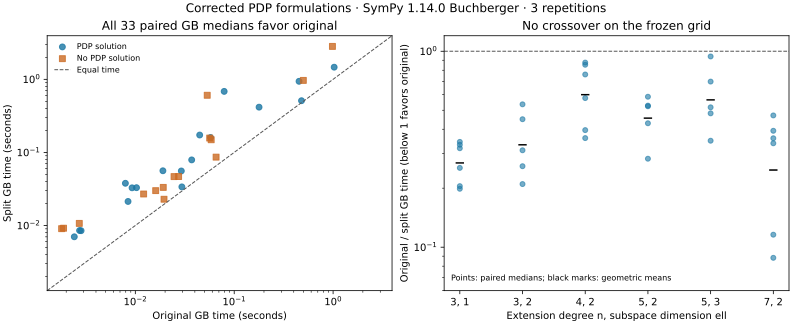

# Matched Semaev systems: corrected PDP, small-field Buchberger comparison

**Measured 24 November 2026. No speedup reproduced on this grid.** The split
formulation is slower in all 33 paired median GB times; the median slowdown is
2.55x (range 1.06–11.33x). All 198 timed solves and 66 separate diagnostic
runs finish without timeout or error. Every timed solve recovers exactly the
independently enumerated set of ordered x-coordinate triples. This compares
corrected PDP formulations, not the unequal raw polynomial zero sets.

This is SymPy 1.14.0 Buchberger on small fields (n=3,4,5,7), not Magma F4 at
the published n=23, ell=6 parameters. It neither reproduces nor contradicts
the published Magma result. It establishes no universal or asymptotic runtime
claim. Three repetitions and shared-host timings do not establish statistical
significance for each individual difference, especially the smallest one.
The added membership equations and explicit infinity recovery also differ
from a raw-system benchmark and can change the GB behavior.



## Correctness finding and complete formulation

The raw affine split omits tuples of the original S4 zero set. Two causes are
visible: specialization can drop both quadratics' leading coefficients, and
the quadratics can share an irreducible quadratic factor without a root in the
base field. The latter can involve coordinates that do not lift to E(k).

For the actual point-decomposition problem, both timed formulations impose
the same rational-point membership constraints on xi. The split solver also
recovers the infinity branch (x,x,r), with x in the factor base and r=x(R)
in V, without a GB call; this work is included in recovery time. Solutions
from both branches are deduplicated. The resulting equality with the PDP has
a [complete written proof](CORRESPONDENCE.md), conditional only on the standard
defining property of summation polynomials, not a genericity or gcd hypothesis.
The proof is not Lean-checked.

The independent point-enumeration audit covers every a, nonzero b and affine
rational target over GF(4) and GF(8), plus a in {0,1}, b in {1,3} over GF(16),
with V equal to the field:

| Exact audit quantity | Count |
| --- | ---: |
| Curves | 72 |
| Affine rational targets | 556 |
| Coordinate triples tested, across targets | 478208 |
| Raw S4 zeros absent from the finite-u split | 10372 |
| Raw finite-u split zeros absent from S4 | 0 |
| Actual PDP tuples absent from the finite-u split | 1966 |
| Corrected PDP target-set mismatches | 0 |

These counts include both target signs where distinct. They are aggregate
tuple counts, not counts of unique curves or of index-calculus relations.
`correctness.json` contains separate classifications and explicit witnesses.
The test suite additionally checks field multiplication against carry-less
polynomial reduction, S4 against the 4x4 Sylvester determinant, and both
descents against extension-field evaluation on every Boolean assignment of
the test instance.

## Frozen matched benchmark

The [protocol](PROTOCOL.md) was committed with the frozen inputs and exact
controls before the measured run, at `8f1564d`. Six (n,ell) configurations,
three seeds and two target categories were specified. Three unavailable
no-solution categories are recorded in `instances.json`, leaving 33 cases:
18 with a PDP solution and 15 without. No case was replaced to obtain a win.

Each pair uses the same curve, V, target, coordinate basis, Boolean field
equations and membership constraints. Both calls use
`groebner(method='buchberger', order='grevlex', modulus=2)`. The split adds
the full n-bit auxiliary block. Fresh processes and alternating paired order
are used for three repetitions. Primary metric: GB-call time. Input
construction, FGLM conversion plus complete recovery, total time, process
wall time, peak RSS and separate diagnostics are recorded. Imports and
interpreter startup are included only in process wall time and RSS. Oracle
generation is outside solver timings; exact output comparison is separately
timed and excluded from the reported solver total.

| n | ell | Complete pairs | Geometric mean original/split GB time | Range |
| ---: | ---: | ---: | ---: | ---: |
| 3 | 1 | 6 | 0.269 | 0.199–0.345 |
| 3 | 2 | 5 | 0.333 | 0.210–0.536 |
| 4 | 2 | 6 | 0.600 | 0.360–0.875 |
| 5 | 2 | 5 | 0.456 | 0.283–0.586 |
| 5 | 3 | 5 | 0.565 | 0.349–0.941 |
| 7 | 2 | 6 | 0.248 | 0.088–0.470 |

Ratios below one favor the original. No crossover appears on this grid.
Both solution strata favor the original: their median ratios are 0.353
(solutions) and 0.450 (no solution). All 33 total-time medians also favor
the original. Peak process RSS is about 59 MB, mostly the common runtime;
the median original/split RSS ratio is 0.998, so this gives no material memory
improvement. Per-repetition numbers, not only averages, are retained.

## What the available diagnostics explain

For n=5, ell=3, seed=0 with a solution:

| Quantity | Original | Split |
| --- | ---: | ---: |
| Boolean variables | 9 | 14 |
| Input degree | 6 | 3 |
| Coordinate-equation terms, membership included | 707 | 214 |
| S-polynomial calls, diagnostic run | 493 | 434 |
| Largest returned S-polynomial degree | 6 | 4 |
| Largest returned S-polynomial term count | 149 | 52 |
| Median GB time (seconds) | 1.02545 | 1.46465 |

Thus lower degree, fewer input terms and even fewer S-polynomial calls do
not suffice to predict a runtime win. In another case (n=7, ell=2, seed=0,
no solution), split S-polynomial calls rise from 56 to 263 while the largest
returned degree falls from five to four; the median GB time rises from
0.05334 to 0.60448 seconds. This is consistent with more work in the larger
ring, but the counters do not isolate reduction cost or establish causality.

These are instrumented S-polynomial outputs, not every intermediate polynomial
and not the solving degree or degree of regularity. The output-basis maximum
degree is recorded separately. Buchberger here constructs no Macaulay matrices;
actual matrix dimensions, sparsity and ranks are unavailable and explicitly
null. Investigating those quantities requires an F4/F5 backend.

## Records and reproduction

- `PROTOCOL.md`: frozen design, limits, selection and cost accounting.
- `instances.json`: all inputs, exact oracle tuple sets and missing categories.
- `correctness.json`, `audit.log`: exhaustive audit and counterexamples.
- `environment.json`: software/hardware and measured-source, protocol and input hashes.
- `runs.jsonl`, `benchmark.log`: 264 timed/diagnostic records and progress log.
- `summary.json`: per-case medians and outcomes; `parameter-table.md`: generated table.
- `comparison.svg`, `comparison.png`: figures generated from the saved medians.

From the repository root:

```sh
python3 scripts/check_semaev_matched.py
python3 -m pytest -q tests/test_semaev_matched.py
python3 scripts/report_semaev_matched.py
```

The checker replays the exact controls and input selection, checks measured
source hashes, verifies record coverage and reproduces the summary. It does
not claim to reproduce timings. The saved-record check is also in pytest.

To rerun timings without overwriting the saved record:

```sh
SEMAEV_OUT=$(mktemp -d)
cp experiments/semaev-matched-20261124/PROTOCOL.md "$SEMAEV_OUT/"
python3 scripts/run_semaev_matched.py instances --out "$SEMAEV_OUT"
python3 scripts/run_semaev_matched.py audit --out "$SEMAEV_OUT"
python3 scripts/run_semaev_matched.py benchmark --out "$SEMAEV_OUT"
```

The runner refuses to overwrite an existing `runs.jsonl`. The next performance
experiment should use an F4 backend and a separately frozen larger grid,
including the published parameter region if feasible. This null result should
remain alongside any later positive results.
