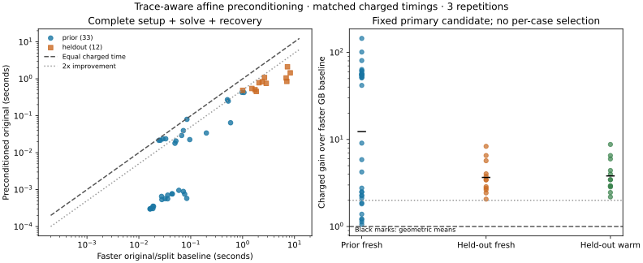

# Trace-aware affine preprocessing: a measured improvement to the GB path

**24 November 2026.** The fixed primary candidate reduces charged solver time
by a geometric mean of **12.31x on 33 prior cases** and **3.67x on 12 held-out
cases**, against the faster original/split GB baseline. All 135 primary
repetitions complete with the exact expected ordered PDP x-coordinate tuples.
The primary candidate has the lower observed median in every case.

These are SymPy 1.14.0 Buchberger results with complete setup, preprocessing
and recovery charged. Existing native linearized root-finding (LRF) remains
faster overall: its geometric-mean advantage over this candidate is 7.46x on
the prior cohort and 963.23x on the held-out cohort. This is a substantial
improvement to the GB implementation path, not a new best PDP algorithm or
an ECDLP exponent improvement. No F4-backend advantage is established here.



## Algorithm and correctness

The default candidate is `original_preconditioned`, chosen before timings.
It adds valid trace constraints, echelonizes the Boolean coefficient-row
span with high-degree columns first, extracts affine consequences, substitutes
their pivot variables and repeats. A composed affine map recovers every
eliminated bit. The unchanged SymPy backend solves only the remaining
nonlinear system. Contradictions and free residual cubes need no GB call.
No tuple oracle or assignment search enters preprocessing.

For E:y²+xy=x³+ax²+b, phi(O)=0 and phi(P)=Tr(x(P)+a) form a homomorphism
E(k)->GF(2), by the addition/doubling formulas. Consequently a rational
three-summand PDP satisfies Tr(x1+x2+x3+r)=0. The finite S3 split receives
Tr(x1+x2+u+a)=Tr(u+x3+r+a)=0. The rational-point membership constraints and
the split's separately recovered infinity branch are essential.

The [written proof](CORRECTNESS.md) covers the trace identities and exact
Boolean solution bijections. It is not kernel-checked. The trace and affine
elimination ideas are standard; this contribution is the exact implementation
and the controlled cost evidence. Tests include 420 generic Boolean systems,
140 satisfiable systems with hidden affine maps, exhaustive small-field
PDP checks, and independent enumeration of every frozen tuple oracle.

All GB methods use a shared fast membership builder: lift-test only the
coordinates in V, instead of scanning k². Its equations are checked against
the audited builder. This improvement is applied equally to baselines and
candidates, so it is not counted as a candidate speedup.

## Frozen fresh-process experiment

The protocol, candidate and 45 inputs were committed at `e47335e` before
the measured run. The primary is fixed globally; no method is selected by
the timing of an individual case. The preconditioned split is a prespecified
secondary candidate. All 33 earlier inputs are reused; the 12 new cases use
(n,ell)=(7,3),(9,3),(11,3), seeds 3,4, with and without PDP solutions.

Three fresh-process repetitions per case and method use a deterministically
rotated order and one solver at a time. Charged total is input construction,
encoding, affine preprocessing, GB computation, FGLM and complete recovery.
Oracle construction and verification, imports and interpreter startup are
separate; process wall time is retained. A C-kernel readiness check is recorded
once outside repeated-target LRF time. Every LRF call still charges its context
construction, native solve and expansion to the same ordered tuple set.

| Method | Successful repetitions | Ten-second GB timeouts |
| --- | ---: | ---: |
| Original | 135 | 0 |
| Split | 105 | 30 |
| Original, preconditioned (primary) | 135 | 0 |
| Split, preconditioned (secondary) | 108 | 27 |
| Existing LRF plus infinity correction | 135 | 0 |

Every successful output matches its exact oracle. There are no process
timeouts, errors or unrun jobs. Timeouts are retained, not silently removed.
The shared host and three repetitions do not establish a statistical or
per-instance universal runtime theorem. The smallest prior-case gain is
only 1.055x; the practical target is a cohort geometric mean of at least 2x.

## Censoring and the original gate

The strict original complete-pair gate is **not fully evaluable** for the
held-out cohort: ten split cases time out. `target.json` therefore retains
`met: false` for that completeness requirement. Among fully completed pairs,
the primary has a 12.31x geometric-mean gain on all 33 prior cases and a
2.38x gain on the two complete held-out pairs. These complete-pair summaries
remain in `summary.json` and `aggregate-table.md`.

A [separate interval analysis](CENSORING-FOLLOWUP.md), added after the first
timeouts and before the run finished, includes every case without treating
a cap as an exact runtime. The original median is below the split's lower
timing bound in each censored case, so the faster baseline
median is resolved exactly in all 45 cases. The exact slow split runtime
is still unknown and never invented.

| Cohort | All cases | Primary complete | Conservative geometric-mean gain | Cases with censored baseline | Best baseline medians resolved |
| --- | ---: | ---: | ---: | ---: | ---: |
| Prior | 33 | 33 | 12.314 | 0 | 33 |
| Held-out | 12 | 12 | 3.666 | 10 | 12 |
| All | 45 | 45 | 8.914 | 10 | 45 |

The secondary analysis supports the practical target; it does not relabel
the original gate as passed. The plot includes all 45 resolved best-baseline
medians, including the ten cases whose slower split baseline is censored.

## Warm-process confirmation

The [warm protocol](WARM-PROTOCOL.md) was committed at `da09bb0` before warm
measurements, after the fresh-process prior gain and some held-out timeouts
had been observed. It keeps the same primary candidate and all 12 held-out
inputs, warms SymPy once and runs three repetitions of the original, split
and primary in one long-lived process. This checks whether cold object
initialization accounts for the improvement. No implementation tuning or
case selection is performed. Warm records and the conservative summary live
under `warm/`; their check does not replay timing.

The warm confirmation gives a **3.81x conservative geometric-mean gain on
all 12 held-out cases** (case range 2.188–8.769x). All 36 primary and 36
original repetitions complete with exact outputs; the split has six successes
and 30 GB timeouts. Its bounds resolve the faster baseline median in all
12 cases, so no capped runtime is assigned an exact value. The warm protocol's
2x practical confirmation target is supported.

The inherited warm-process hash seed was unset; all methods shared one
process and hash state (`warm/launch.json`). This is a separate warm
execution, not a causal isolation of cache effects. The performance gain
is observed with both the fresh and warm execution conditions.

## Mechanism and limits

Preprocessing resolves 17 prior cases without a GB call: ten are certified
inconsistent, and seven leave a free cube whose complete recovery is charged.
The larger cases retain a nonlinear core. For the first held-out solution
case (n=7, ell=3, seed=3):

| Quantity | Original | Primary candidate |
| --- | ---: | ---: |
| Active variables entering GB | 9 | 8 |
| Median preprocessing time | negligible bookkeeping | 0.00156 s |
| Median GB time | 6.82079 s | 0.98828 s |
| Median charged total | 6.89947 s | 1.05450 s |

Thus the gain persists in a case dominated by nonlinear GB work, rather than
only in tiny systems with startup overhead. Existing LRF takes 0.000768 s
on that same case. Affine substitution does not
increase Boolean input degree, but no general decrease in solving degree
or runtime is proved. The row ranks/columns recorded by preprocessing are
its own coefficient matrices, not F4 Macaulay matrices.

The secondary preconditioned split is not a universal improvement: it loses
17 of 33 prior comparisons and has 27 held-out repetition timeouts. It was
not selected independently on favorable cases. The primary candidate is the
default API; the secondary remains available for controlled comparisons.

## Code and reproduction

- `csd/boolean_affine.py`: generic exact reducer and recovery map.
- `csd/semaev_preconditioned.py`: shared input builder and complete PDP solver.
- `scripts/run_semaev_preconditioned.py`: frozen cases and fresh-process runner.
- `scripts/analyze_semaev_timing_bounds.py`: conservative secondary intervals.
- `scripts/run_semaev_preconditioned_warm.py`: warm confirmation and checker.
- `instances.json`, `environment.json`, `hardware.json`: frozen inputs and provenance.
- `runs.jsonl`, `benchmark.log`, `summary.json`, `timing-bounds.json`: all 675
  fresh records, progress log, complete-pair and all-case results.
- `warm/`: separate warm inputs, environment, raw records and summary.
- `VALIDATION.md`: local checks and evidence boundaries.
- `comparison.svg/png`, `aggregate-table.md`, `bounds-table.md`: derived displays.

```sh
python3 scripts/check_semaev_preconditioned.py
python3 scripts/run_semaev_preconditioned_warm.py check
python3 -m pytest -q tests
python3 scripts/check_publication_artifacts.py
```

The checks replay exact case selection and independently enumerate y over V,
verify the source/input/protocol hashes, record coverage, phase accounting and
summaries. They do not reproduce timing. To rerun the fresh benchmark without
overwriting saved measurements, use a new directory:

```sh
SEMAEV_OUT=$(mktemp -d)
cp experiments/semaev-preconditioned-20261124/PROTOCOL.md "$SEMAEV_OUT/"
python3 scripts/run_semaev_preconditioned.py instances --out "$SEMAEV_OUT"
python3 scripts/run_semaev_preconditioned.py benchmark --out "$SEMAEV_OUT"
```

The frozen warm runner exposes its output directory as a module setting.
Replay it safely into another empty directory without editing the measured
source:

```sh
SEMAEV_WARM_OUT=$(mktemp -d)
OPENBLAS_NUM_THREADS=1 python3 - "$SEMAEV_WARM_OUT" <<'PY'
from pathlib import Path
import sys
sys.path.insert(0, "scripts")
import run_semaev_preconditioned_warm as warm
warm.OUT = Path(sys.argv[1])
warm.run()
PY
```

Saved runners refuse to overwrite an existing raw record. The implementation
gains reported here are limited to these fields, complete-PDP encodings,
variable orders and backend. A larger-grid F4 comparison is still required
before transferring a performance claim to that backend.
